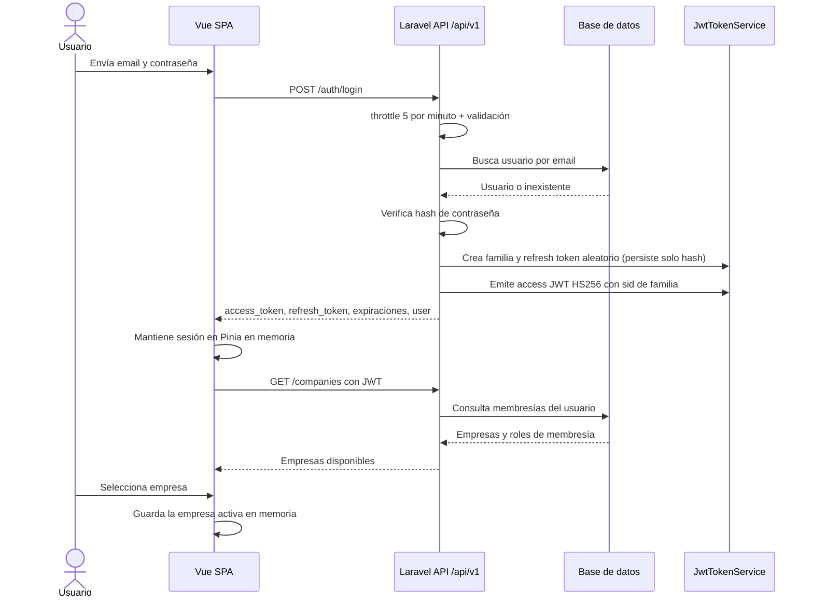
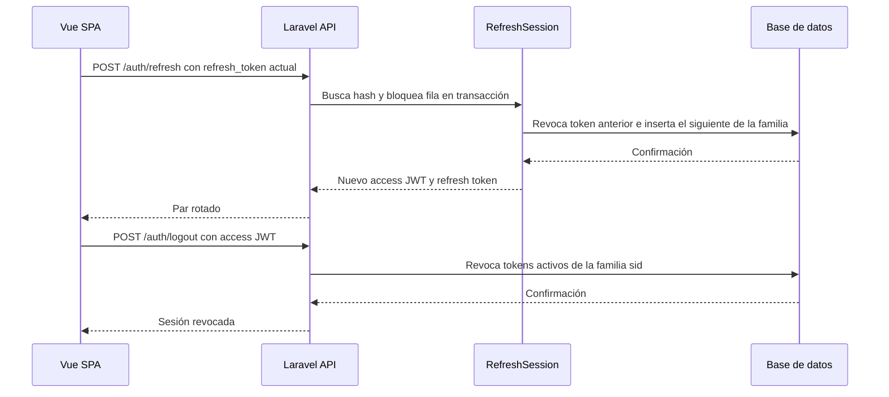
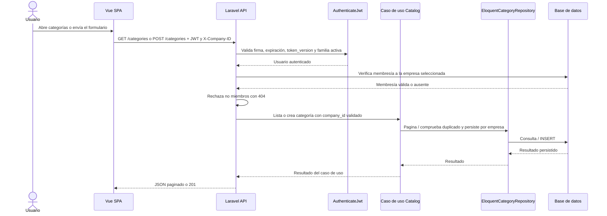

# Diagramas de secuencia

## Flujos implementados actualmente

Los diagramas siguientes describen únicamente flujos implementados. El login
entrega un access token JWT y un refresh token opaco; el refresh rota el token y el
reuso revoca su familia. El logout revoca solo la sesión actual. No hay checkout ni
persistencia de auditoría.

### Inicio de sesión y selección de empresa

### Refresh rotativo y logout

### Consulta de categorías y creación

## Flujos requeridos, aún no implementados

No se dibujan como si fueran comportamiento real:

1. Escaneo y confirmación de venta.
2. Recepción de compra e inventario.
3. Creación/actualización de suscripción.
4. Devolución de venta.

Se agregarán diagramas de esos flujos cuando existan endpoints, casos de uso,
transacciones e invariantes verificables.
